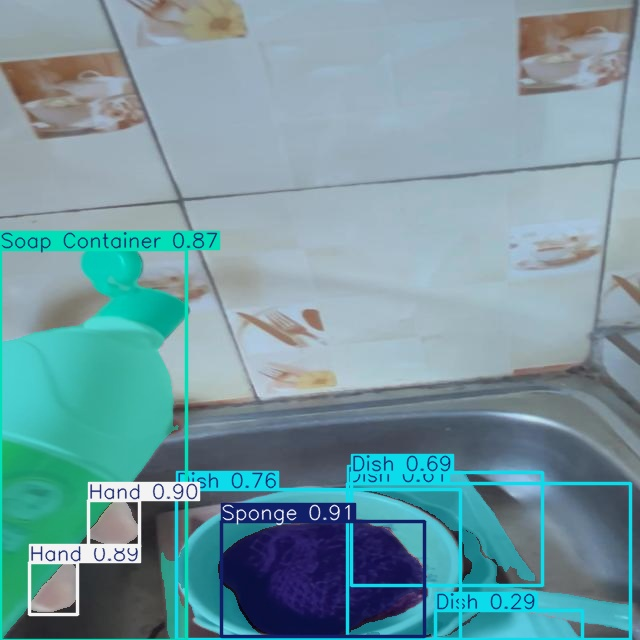

# Egocentric Dishwashing Segmentation

Instance segmentation of hands and kitchen objects in first person (egocentric) video, filmed in a Lagos home kitchen. The project covers the full data pipeline: collecting footage, auto labeling, human review, training and evaluation.

**Main finding:** AI auto labeling did most of the work, but motion blur caused 7 of the 9 labeling errors I logged. On blurry frames, one object came back as up to 224 separate predictions until the labeling workflow was fixed.



## Results

| Metric | Score |
| --- | --- |
| Mask mAP50 (test set) | 0.874 |
| Mask mAP50-95 (test set) | 0.736 |
| Speed | about 10 ms per image on a T4 GPU |

| Class | Test instances | Mask mAP50 | Mask recall |
| --- | --- | --- | --- |
| hand | 34 | 0.959 | 0.917 |
| basin | 5 | 0.995 | 1.000 |
| dish | 33 | 0.727 | 0.659 |
| sponge | 14 | 0.693 | 0.571 |
| soap container | 1 | 0.995 | 1.000 |

What the numbers say:

- **Hands are the strongest result** (0.959), even with motion and wet skin.
- **The sponge is the weakest:** it finds only about 6 in 10 sponges. The dark purple mesh blends with hands and shadow, the same problem seen during labeling.
- **Dishes are harder than they look:** three similar pink dishes often stack and overlap, so the model sometimes merges or splits them.
- **Basin and soap container scores are not reliable:** the test set has only 5 basins and 1 soap bottle.

Model: YOLO26 nano segmentation, trained for 85 epochs with early stopping (patience 20, best epoch 65, about 9 minutes) on a free Google Colab T4 GPU.

## Data collection

- **Task:** washing 3 dishes by hand, with water in a basin, a sponge and dish soap
- **Camera:** phone strapped to the chest, portrait, moving with the body
- **Footage:** 4 minutes 6 seconds, sampled at 1 frame per second, giving 246 frames
- **Split:** 173 train, 49 valid, 24 test

A first video filmed on a fixed phone stand was dropped before labeling. A fixed camera is not egocentric: real first person footage moves, shakes and loses objects at the edges, and that is what makes it useful for training.

## Labels and rules

| Label | What is outlined |
| --- | --- |
| hand | Fingers to wrist, each hand separately |
| dish | The 3 light pink speckled dishes (square, wavy edged, handled) |
| basin | The orange water basin, not the water inside |
| sponge | The purple mesh scrubber |
| soap container | The dish soap bottle |

Rules: outline only what is visible; do not guess hidden edges; foam on a dish counts as dish; never label reflections or the water; truly empty frames are marked Null.

Labels were renamed during the prompt test: "plate" became "dish" because one dish is deep and handled, and "bowl" became "basin" so the two would not be confused.

## Auto labeling: what went wrong and how it was fixed

Labels were drafted with Roboflow Auto Label (GPT-6.1 Terra + SAM 3) from short text prompts, then every frame was reviewed by hand.

| Test | Basin predictions on one blurry frame |
| --- | --- |
| Prompt: "orange plastic bowl holding water", masks | about 200 |
| Prompt: "translucent orange plastic basin holding water", masks | 224 |
| Same prompt, polygons | 198 |

Lessons:

1. **Prompt colour words decide whether an object is found at all.** Describing the dishes as "brown" missed them; "light pink speckled" found them.
2. **The prompt was not the cause of the duplicates.** Changing it back made no difference. The cause was motion blur: on blurry close ups, one object broke into hundreds of fragments.
3. **The fix:** merge overlapping predictions (overlap threshold 0.1) and keep only the largest connected piece of each outline, so every object becomes one polygon.

## Human review

All 246 frames were reviewed. Logged corrections from frames 1 to 28:

| Error type | Count | Main cause |
| --- | --- | --- |
| Missed object | 5 | Blur (3), edge of frame (1), covered by hand (1) |
| Extra label | 2 | Blur |
| Wrong shape | 2 | Blur |
| Null (empty frame) | 1 | Empty sink |

Patterns across the full review: hand outlines often stopped at the wrist in poor light and had to be redrawn; the round dish was sometimes labeled as basin.

## Limitations

- **Near duplicate frames across splits.** Frames 1 second apart look almost the same, so the random split puts near copies in train and test. Test scores are likely higher than performance on new footage. Next step: film a second clip and use it as an independent test set.
- **Small dataset:** one person, one sink, one session.
- **Portrait, chest mounted camera:** narrower view than landscape, and it follows the body, not the eyes.
- **Still water only:** no running tap.
- **One validation image skipped:** it mixed a box label with outline labels, so training ignored it. To fix in Roboflow for v2.

## Run it yourself

1. Download the dataset from Roboflow: [ADD LINK]
2. Open `notebooks/egocentric_dishwashing_train_v1.ipynb` in Google Colab with a T4 GPU.
3. Upload the dataset zip and run the cells top to bottom.

## Repository

```
README.md
notebooks/egocentric_dishwashing_train_v1.ipynb
results/   training charts, confusion matrix, sample predictions
```

## Tools and credits

- **Roboflow:** dataset hosting, Auto Label (GPT-6.1 Terra + SAM 3), annotation review and dataset export
- **Ultralytics YOLO26:** the segmentation model and training code
- **Google Colab:** free T4 GPU for training
- **Claude (Anthropic):** AI assistant I used to debug the auto labeling workflow and draft the training notebook.
- Filming, labeling review, training runs and the findings are my own work.

Dataset license: CC BY 4.0.

## Author

Mary Imeabasi Udo, Data Scientist and AI Engineer, Lagos.
[LinkedIn](https://www.linkedin.com/in/udomary) · [GitHub](https://github.com/MaryGit-24)
